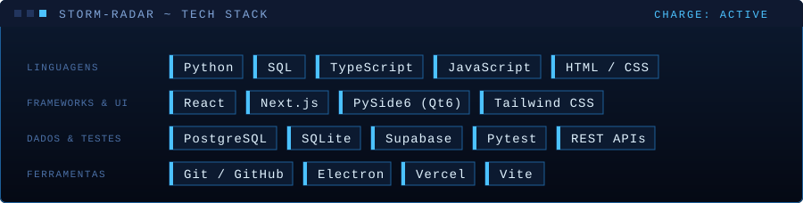

<!-- 🌪️ BANNER + TYPING -->

  

  

<!-- ⚡ DIVISOR + TELEMETRIA -->

  

  

  

<!-- ⚡ STACK -->

  

  

<!-- 🌪️ PROJETOS REAIS -->

  
  

  
  

  

  

<!-- ⚡ REDES SOCIAIS & RODAPÉ DA TEMPESTADE -->

  
  
  
  
  

  

