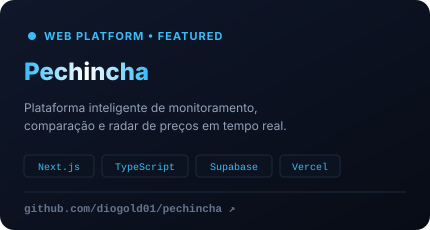
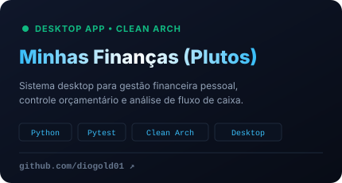

<!-- ✨ CABEÇALHO ANIMADO -->

  

<!-- ⚡ TEXTO DIGITANDO DINÂMICO -->

  

<!-- 🌟 DIVISOR VETORIAL -->

  

<!-- 💻 FICHA TÉCNICA DO DESENVOLVEDOR -->

  

<!-- 🌟 DIVISOR VETORIAL -->

  

<!-- 🛠️ ARSENAL TECNOLÓGICO & BARRAS DE XP -->

  

  
  
  
  
  
  
  
  
  

<!-- 🌟 DIVISOR VETORIAL -->

  

<!-- 🚀 PROJETOS EM DESTAQUE -->
<h3 align="center">✦ PROJETOS EM DESTAQUE ✦</h3>

  
  

<!-- 🌟 DIVISOR VETORIAL -->

  

<!-- 📊 STATUS & MÉTRICAS DO GITHUB -->
<h3 align="center">✦ MÉTRICAS DO SISTEMA & ATIVIDADE ✦</h3>

  
  

  

<!-- 🐍 COBRINHA ANIMADA DE COMMITS (Gerada pelo workflow .github/workflows/snake.yml) -->

  

<!-- 🌟 DIVISOR VETORIAL -->

  

<!-- 💌 CONEXÕES & CONTATO -->
<h3 align="center">✦ VAMOS CONVERSAR? ✦</h3>

  
  
  

<!-- 🌙 RODAPÉ ANIMADO -->

  

